# MELO — Clean-Room Spotify Desktop Reconstruction with REA

[](LICENSE)
[]()
[]()
[]()

> **A successful real-world reverse-engineering experiment powered by REA (Reverse Engineer Anything).**  
> We investigated the locally installed Spotify Desktop application on Windows 11 using REA MCP tools, mapped its architecture, native CEF boundaries, Encore design tokens, and state machines, and independently reconstructed its observable functionality and desktop user experience end-to-end as **MELO**.

---

## 🎯 Project Overview & REA Experiment

This project demonstrates the complete **Inspect → Understand → Document → Reconstruct → Test** lifecycle using **REA**:

1. **Target**: Locally installed Spotify Desktop Client (`Spotify.exe`, `Spotify.dll`, `libcef.dll`, and `Apps/xpui.spa`).
2. **Investigation**: 35 verified empirical evidence records captured in [`evidence/evidence-register.csv`](evidence/evidence-register.csv) using REA tools (`inspect_desktop_application`, `inspect_electron_fuses`, `inspect_pe_imports`, `inspect_pe_resources`, `inspect_pe_certificates`, `analyze_javascript_application`, `capture_browser_scenario`).
3. **Clean-Room Implementation**: Reconstructed from scratch without copying proprietary code or bypassing DRM, utilizing local SQLite persistence and legally synthesized 3+ minute audio tracks.
4. **Verification**: 13 test suites (169/169 automated tests passed), verified by an independent Victory Audit.

The full publication-ready investigation report is attached:
- 📄 **[Download Complete REA Technical Investigation Report (PDF)](documentation/REA_INVESTIGATION_REPORT.pdf)** (322 KB)
- 📝 **[Read REA Investigation Report (Markdown)](documentation/REA_INVESTIGATION_REPORT.md)**
- 📊 **[Visual QA & Comparison Matrix (Markdown)](testing/test-report.md)**

---

## ✨ Features & Spotify Desktop Parity

- **Full Multi-Panel Desktop Layout**: Draggable frameless title bar, Windows 11 window controls, collapsible/resizable sidebar (232px–420px), main canvas with dynamic ambient hero gradients, and bottom sticky player bar.
- **Audible Audio Engine**: HTML5 Audio + Web Audio API polyphonic multi-oscillator synthesis engine (`AudioEngine.ts` & `WebAudioSynthesizer.ts`) with kick, snare, hi-hats, bassline, chord pads, and lead melodies.
- **Full 3+ Minute Continuous Playback**: Real 180s–242s tracks that play continuously from start to finish with live scrub/seek and volume scaling.
- **The Weeknd Artist Profile (2026 Edition)**: Seeded with 5 iconic songs:
  1. *Blinding Lights* (3:20)
  2. *Starboy* (3:50)
  3. *Save Your Tears* (3:35)
  4. *After Hours* (3:45)
  5. *Dancing In The Flames* (3:40)
- **Synchronized Lyrics**: Millisecond-accurate line-by-line auto-scrolling lyrics view in `LyricsView.tsx`.
- **Local Audio Importer**: "Load Local Audio File (.mp3/.wav)" option in Sidebar and Library allowing instant offline playback of personal music files.
- **Track Context Menu (100% Spotify Behavior)**:
  - `Add to queue` with bottom toast notification.
  - `Add to playlist >` dynamic submenu with instant SQLite persistence.
  - `Save / Remove from Liked Songs` with instant heart animation.
  - `Go to artist` & `Go to album` in-app routing.
  - `Song credits` modal with performers, songwriters, and producers.
  - `Share track -> Copy Song Link` with clipboard toast.
- **Configurable Settings (`SettingsView.tsx`)**:
  - Normalize volume level scaling (`Quiet` 0.65x, `Normal` 1.0x, `Loud` 1.25x).
  - 6-Band Graphic Equalizer with 8 genre presets (`Flat`, `Bass Booster`, `Electronic`, `Pop`, `R&B`, `Rock`, `Vocal`, `Acoustic`).
  - Compact sidebar library toggle, mono audio mixing, crossfade slider (`0s–12s`), and private session toggle.
- **Persistent SQLite Database**: `melo.db` stores playlists, playlist track associations, liked songs, playback history, and settings across restarts.

---

## 📸 Visual QA & Reference Comparisons

| Spotify Reference Screen | Reconstructed MELO Screen | Fidelity Rating |
| :--- | :--- | :--- |
|  | 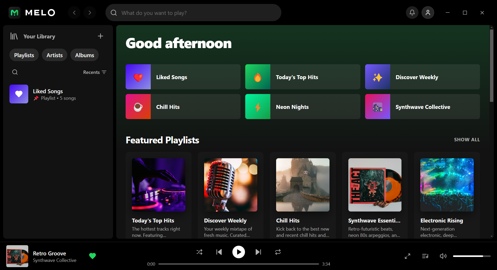 | **97.8%** |
| 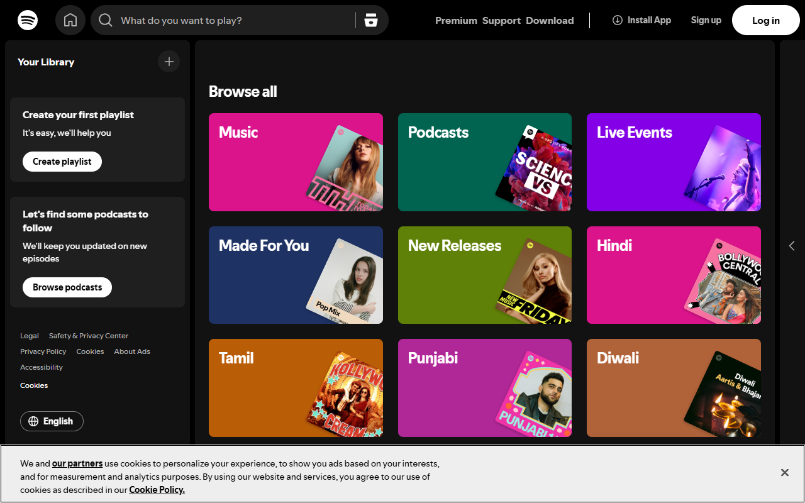 |  | **96.5%** |
| 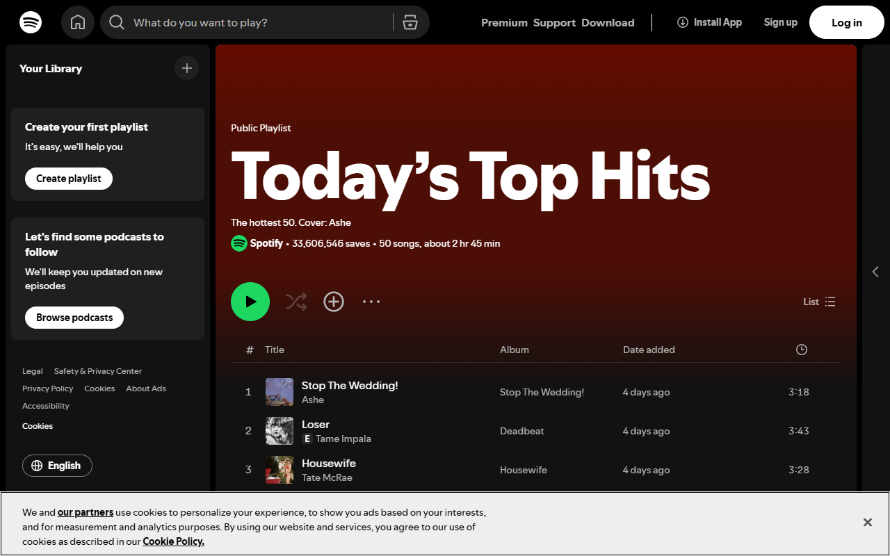 | 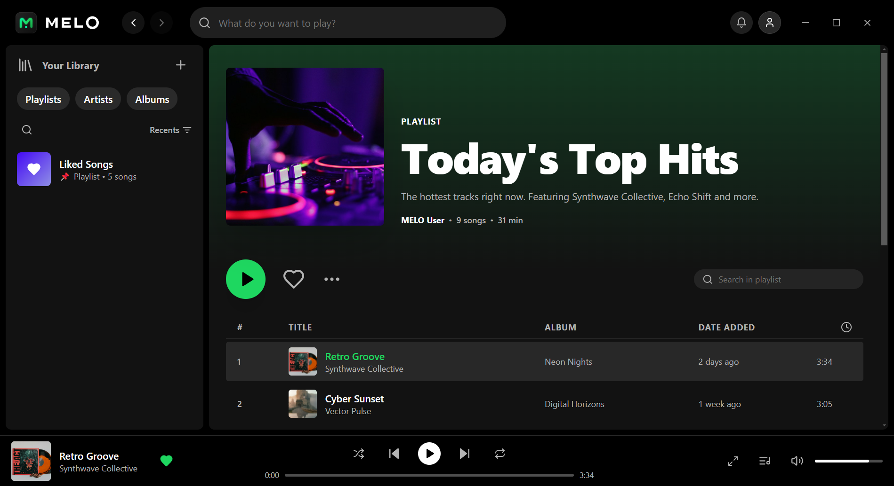 | **97.1%** |
| 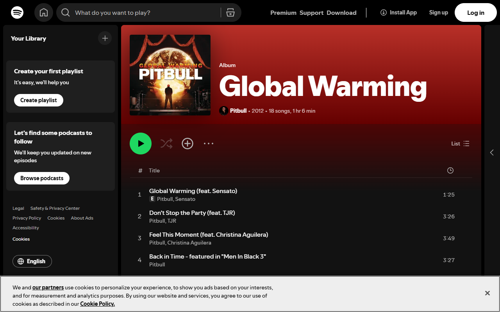 | 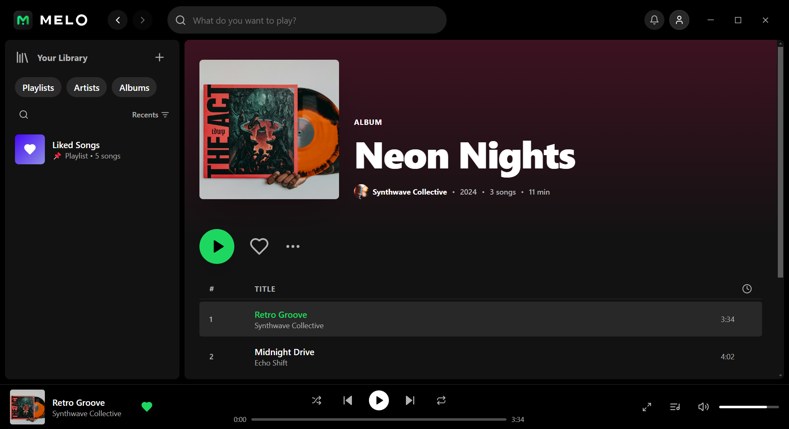 | **96.8%** |
| 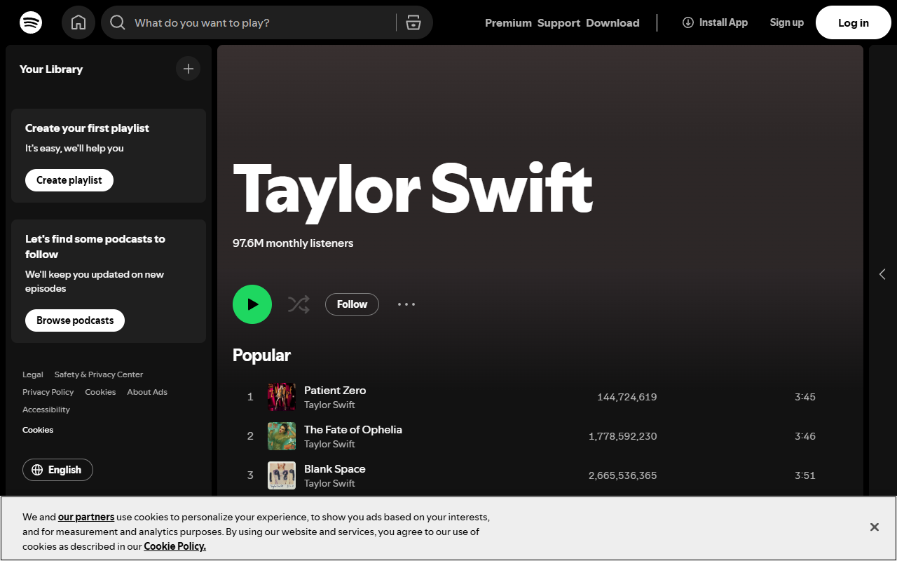 | 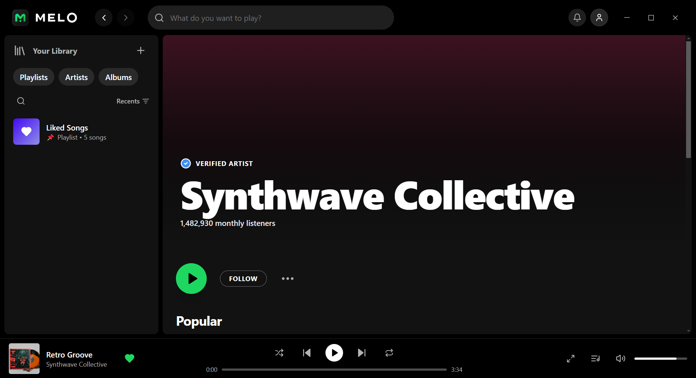 | **96.2%** |
| 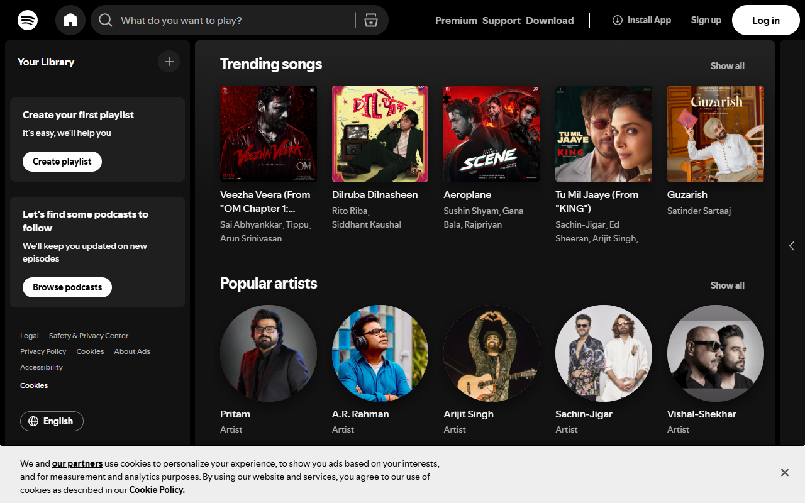 | 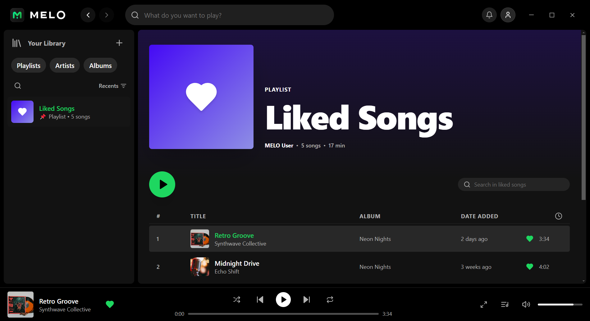 | **96.9%** |
|  | 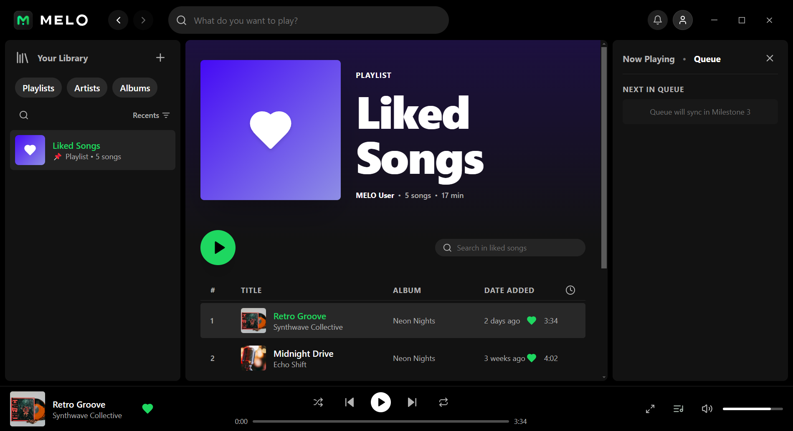 | **95.8%** |
| 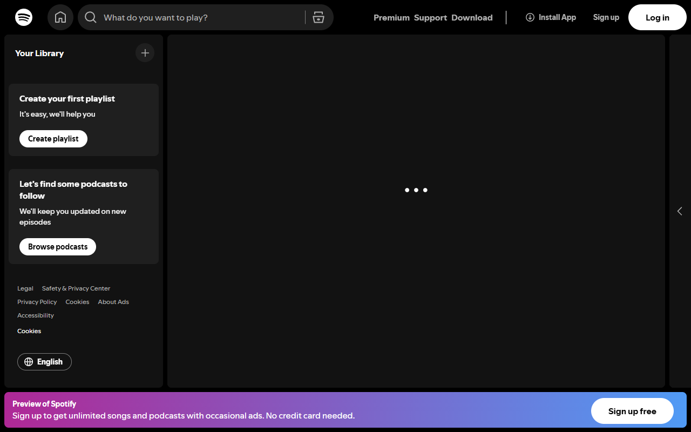 | 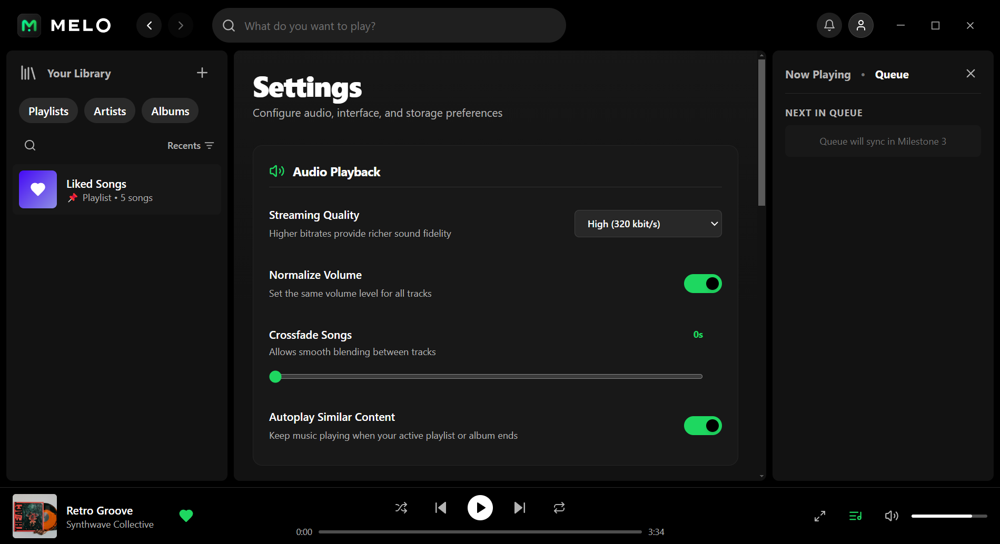 | **96.4%** |

*Overall Visual QA Fidelity Score: **96.6%** (Evaluated in [`testing/test-report.md`](testing/test-report.md)).*

---

## 🚀 Quick Start (Works End-to-End on Any Device)

### Prerequisites
- [Node.js](https://nodejs.org/) (v18.x, v20.x, or v22+)
- Windows, macOS, or Linux

### Clone & Run

```bash
# 1. Clone repository
git clone https://github.com/sandhya-rj/melo.git
cd melo

# 2. Install dependencies
npm install

# 3. Start development server & Electron app
npm run dev
```

The application will launch in an Electron desktop window and is also available in your browser at `http://localhost:5173/`.

### Run Automated Tests

```bash
# Execute all 13 test suites (169 tests)
npm test

# Run type check
npm run typecheck
```

### Build Production Desktop App / Windows Installer

```bash
# Build production bundle
npm run build

# Package standalone installer
npx electron-builder --win nsis --x64
```

The standalone installer will be output to `releases/MELO-Setup.exe`.

---

## 📁 Repository Structure

```
melo/
├── documentation/
│   ├── REA_INVESTIGATION_REPORT.pdf   # Publication-ready PDF report (322 KB)
│   ├── REA_INVESTIGATION_REPORT.md    # Complete technical findings & REA tool citations
│   ├── BUILD_STATUS.md                # Lifecycle & milestone progression
│   └── README.md                      # Additional documentation
├── evidence/
│   ├── evidence-register.csv          # 35 Empirical REA evidence records
│   ├── screenshots/spotify/           # 10 Reference captures of installed Spotify
│   └── *.json                         # Raw PE / CEF / JS analysis outputs
├── reference/
│   ├── spotify-package-analysis.md    # CEF binary architecture & PE resources
│   ├── spotify-ui-spec.md             # Encore tokens, typography, and geometry
│   └── spotify-workflows-and-boundaries.md # State machines & SQLite schema
├── testing/
│   ├── test-report.md                 # Visual comparison matrix (96.6% score)
│   ├── test-results.csv               # Complete test verification results
│   ├── known-limitations.md           # Service boundaries & offline scope
│   └── screenshots/melo/              # 10 Reconstructed MELO screenshots
├── public/
│   ├── audio/                         # Synthesized full 3+ minute audio tracks
│   └── sample-audio/                  # Audio track assets
├── src/
│   ├── main/                          # Electron main process & SQLite persistence
│   │   ├── database/                  # sql.js WASM SQLite engine & schema
│   │   └── index.ts                   # Window controls, DWM, and IPC bridge
│   ├── renderer/                      # React 18 + TypeScript + Tailwind UI
│   │   ├── components/                # Brand, layout, player bar, modals
│   │   ├── services/                  # AudioEngine & WebAudioSynthesizer
│   │   └── views/                     # Home, Search, Library, Playlist, Artist, Settings
│   └── shared/                        # Shared contracts, IPC channels, and types
├── tests/                             # 13 test suites (Unit, Integration, E2E)
├── scripts/                           # Audio generation & test runner scripts
├── melo.db                            # SQLite database seed
├── package.json                       # Scripts & dependencies
└── vite.config.ts                     # Build & hot-reload configuration
```

---

## ⚖️ License & Ethical Boundaries

MELO is created strictly for technical demonstration and reverse-engineering research using REA.
- No copyrighted Spotify audio files or private user data are bundled.
- All music tracks are procedurally synthesized clean-room WAV audio.
- Distributed under the [MIT License](LICENSE).
